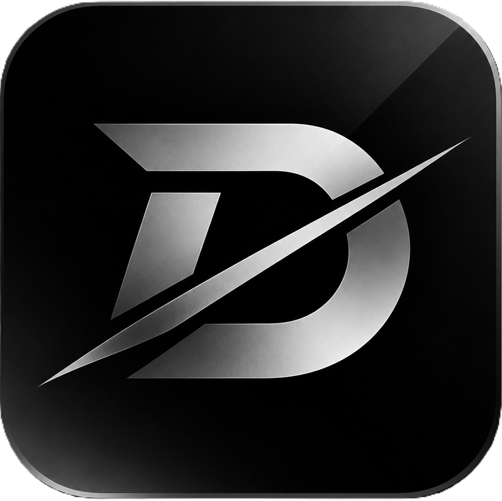

<p align="center">
  
</p>

<h1 align="center">DarkyDesk</h1>

<p align="center">
  A simple Windows desktop panel for serving a local static website and sharing it with a Cloudflare Quick Tunnel.
</p>

<p align="center">
  Windows 10/11 · Electron · Cloudflare Quick Tunnel
</p>

## What it does

Choose a website folder, select a local port, and start or stop the website and its Cloudflare tunnel from one desktop window.

- Serves static files on `127.0.0.1` with common content types and path-traversal protection.
- Shows website and tunnel status, the public HTTPS URL, and tunnel latency.
- Starts and stops only the `cloudflared` process launched by DarkyDesk.
- Keeps the admin panel local; it is not part of the website or tunnel.
- Does not save settings, start automatically, or provide remote-control features.

## Download

**[Open DarkyDesk Releases](https://github.com/x02l/DarkyDesk/releases).** Choose the download that fits how you want to install:

| File | Approx. size | What to expect |
| --- | ---: | --- |
| `DarkyDesk Setup 1.0.0.exe` | 79 MB | Full installer; installs without downloading the app during setup. |
| `DarkyDesk Web Setup 1.0.0.exe` | Under 1 MB | Small installer; downloads the app package from GitHub during setup. Internet required. |
| `DarkyDesk 1.0.0.exe` | 79 MB | Portable build; no installation wizard. |

The web installer also needs the `darkydesk-1.0.0-x64.nsis.7z` app package to be attached to the same GitHub Release. Windows may show a SmartScreen warning because the app is not code-signed.

> **Release status:** The files have been built, but a GitHub Release still needs to be published before these links contain downloads. See [Publishing a release](#publishing-a-release).

## Requirements

- Windows 10 or 11, 64-bit.
- `cloudflared.exe`, installed separately. DarkyDesk does not bundle it.
- Internet access when connecting to Cloudflare. The web installer also needs internet access to download the app.

Install Cloudflare's official client from [cloudflared releases](https://github.com/cloudflare/cloudflared/releases) or with:

```powershell
winget install --id Cloudflare.cloudflared
```

You can also use **Locate cloudflared.exe** in DarkyDesk to select the executable.

## Use the app

1. Install or open DarkyDesk and make sure `cloudflared.exe` is available.
2. Select the folder containing your static website (usually with an `index.html`).
3. Choose a local port, such as `8080`, and select **Start Server**.
4. Open the local site or copy the public HTTPS URL once the tunnel connects.
5. Select **Stop Server** when you are finished.

Anyone with the public URL may view the selected website files. Do not select a folder containing private files.

## Cloudflare Quick Tunnel notes

- Cloudflare assigns a random `trycloudflare.com` URL each time. You cannot choose its name or extension.
- The public HTTPS port is fixed at `443`; only the local website port is configurable.
- Quick Tunnels carry HTTP/HTTPS websites, not arbitrary TCP services.
- Quick Tunnels are intended for testing and do not have an uptime guarantee.

## Build from source

Install [Node.js](https://nodejs.org/) 18 or later, then run these commands in PowerShell:

```powershell
npm ci
npm start
```

Useful project commands:

```powershell
npm test         # Run automated tests
npm run pack     # Create an unpacked Windows app in dist\win-unpacked
npm run dist     # Build the full installer and portable app
npm run dist:web # Build a small web installer and its downloadable app package
```

### Publish the small web installer

The web installer is configured for the public repository `x02l/DarkyDesk` and release tag `v1.0.0`.

1. Build with `npm run dist:web`.
2. Create a GitHub Release with the tag `v1.0.0`.
3. From `dist\nsis-web\`, attach both `DarkyDesk Web Setup 1.0.0.exe` and `darkydesk-1.0.0-x64.nsis.7z` to that release.
4. Publish the release. The small installer downloads the `.nsis.7z` app package from that public release.

Do not rename the `.nsis.7z` file unless you also change the download URL in `package.json` and rebuild the web installer. Release assets in this public repository are downloadable by anyone.

### Publish the source code

To make the repository useful to other developers, publish the project files too. Include `src\`, `assets\`, `build\`, `bin\`, `test\`, `package.json`, `package-lock.json`, `.gitignore`, and this `README.md`. Do **not** upload `node_modules\` or `dist\`; those are generated locally, and the release installers belong in GitHub Release assets instead.

## Tests and verification

`npm test` covers the static server, path traversal checks, URL parsing, input validation, and controller behavior. On Windows, 6 tests pass and 3 POSIX-specific tests are skipped. The Electron window, Windows installer builds, and a real Quick Tunnel serving a temporary test site have been verified.

## Project structure

```text
src\main.js             Electron main process and app lifecycle
src\preload.js          Restricted renderer API
src\controller.js       Website/tunnel orchestration and state
src\staticServer.js     Loopback-only static file server
src\tunnel.js           cloudflared process and URL handling
src\renderer\           English admin panel
assets\                 DarkyDesk branding
build\                  Windows app icon
test\                   Automated tests
```

## Known limitation

If the app is force-terminated (for example, from Task Manager), Windows may leave its `cloudflared` child process running. Close DarkyDesk normally when possible.
